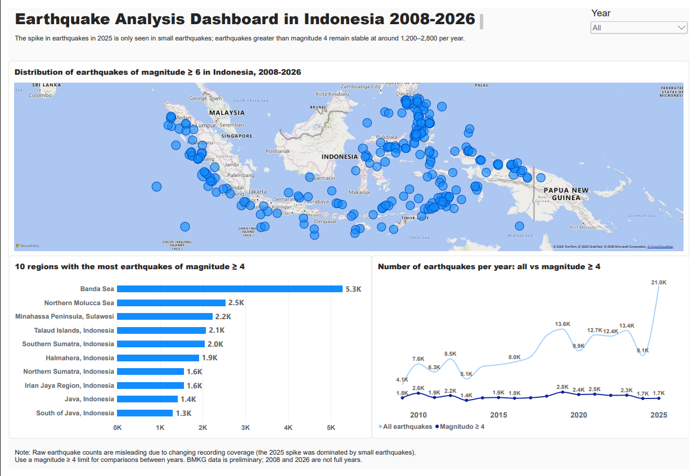

# Earthquake Analysis in Indonesia (2008-2026)

> **Key finding:** The number of recorded earthquakes nearly doubled in 2025 (21,021 events), but the jump does not appear in earthquakes of magnitude 4 and above, which stayed stable at roughly 1,400-2,800 per year in full years (2009-2025). The jump most likely comes from more small earthquakes being recorded, not from more earthquakes actually occurring.

## Goals and questions

This project analyzes the BMKG earthquake catalog to answer three questions:

1. Which regions experience the most earthquakes?
2. Is there a relationship between depth and earthquake strength (magnitude)?
3. Has the number of recorded earthquakes increased, and is that because more earthquakes occurred or because recording practices changed?

## Data source

- Kaggle dataset **Earthquakes in Indonesia** (kekavigi): https://www.kaggle.com/datasets/kekavigi/earthquakes-in-indonesia
- The original data comes from the BMKG Preliminary Earthquake Catalog: https://repogempa.bmkg.go.id/eventcatalog
- File used: `katalog_gempa_v2.tsv` (176,384 rows, 37 columns, starting 1 November 2008). The older `katalog_gempa.csv` was not used because the dataset author marks it as an archive from before BMKG's system migration.
- Dataset license: Open Database; the contents belong to the original authors (BMKG).

## Tools

Python (pandas) on Kaggle for cleaning and analysis, Power BI Desktop for the dashboard.

## Cleaning steps

1. **Selecting columns.** Of the 37 columns, only 8 were used: `eventID`, `datetime`, `latitude`, `longitude`, `magnitude`, `mag_type`, `depth`, `location`. The focal mechanism columns (those ending in FM and the columns after them) were not used because most of their values are empty and they fall outside the scope of this analysis.
2. **Checking missing values.** `magnitude` and `mag_type` are both empty in the same 1,405 rows (about 0.8%), so those rows were dropped from the analysis. `location` is empty in 28 rows.
3. **Parsing time.** The `datetime` column has mixed formats (some with fractional seconds, some without), so it was parsed with `format="ISO8601"` and the year was extracted.
4. **Filtering the region.** Version 2 of the dataset is no longer clipped to Indonesia, so it was filtered with a coordinate box of latitude -11 to 6 and longitude 94 to 142. This leaves **142,286 rows**.
5. **Creating depth classes:** shallow (under 70 km), intermediate (70-300 km), deep (over 300 km).

## Findings

### 1. Raw yearly earthquake counts are misleading

| Year | All earthquakes | Magnitude 4 and above |
|---|---|---|
| 2008 (from November) | 239 | 96 |
| 2009 | 4,134 | 1,823 |
| 2010 | 7,646 | 2,616 |
| 2011 | 6,261 | 1,885 |
| 2012 | 8,510 | 2,217 |
| 2013 | 5,051 | 1,398 |
| 2014 | 7,209 | 1,819 |
| 2015 | 7,511 | 1,874 |
| 2016 | 7,991 | 1,752 |
| 2017 | 8,898 | 1,835 |
| 2018 | 12,517 | 2,113 |
| 2019 | 13,635 | 2,804 |
| 2020 | 9,911 | 2,393 |
| 2021 | 12,653 | 2,450 |
| 2022 | 12,438 | 2,245 |
| 2023 | 13,389 | 2,274 |
| 2024 | 9,097 | 1,716 |
| 2025 | **21,021** | 1,745 |
| 2026 (partial year) | 8,273 | 1,199 |

In 2025 the count of all earthquakes roughly doubled compared with 2024, while earthquakes of magnitude 4 and above barely changed. Large earthquakes are almost always captured by sensors wherever they are, so an increase that appears only among small earthquakes more likely reflects a change in recording. The exact cause (added sensors, changed processing, or something else) cannot be determined from this data.

### 2. Magnitude types alternate between years

The data mixes several magnitude types (`M`, `MLv`, `mb`, `Mw`, and others). Type `M` dominates in 2010-2012, 2019-2022, 2024, and 2026, while `MLv` dominates in 2013-2018, 2023, and 2025. In 2025, about 17,600 of the 21,000 earthquakes are of type `MLv`. Magnitude type is also related to earthquake size: `MLv` averages 3.3 and `M` averages 3.7, while `mb` averages 4.9 and the `Mw` types range from 4.9 to 6.1. So average magnitudes across years from this mixed data cannot simply be compared.

### 3. Large earthquakes are concentrated in eastern Indonesia

Of roughly 36,250 earthquakes of magnitude 4 and above, the top 10 regions account for about 60%.

| Region | Count (magnitude 4+) |
|---|---|
| Banda Sea | 5,278 |
| Northern Molucca Sea | 2,535 |
| Minahassa Peninsula, Sulawesi | 2,231 |
| Talaud Islands | 2,079 |
| Southern Sumatra | 2,047 |
| Halmahera | 1,912 |
| Northern Sumatra | 1,556 |
| Irian Jaya Region | 1,555 |
| Java | 1,411 |
| South of Java | 1,302 |

Regions in eastern Indonesia (Banda, Maluku, North Sulawesi, Talaud, Halmahera) dominate. Northern and Southern Sumatra combined (about 3,600) rank third.

### 4. Depth is not related to strength

| Depth class | Count (magnitude 4+) | Average magnitude |
|---|---|---|
| Shallow (under 70 km) | 24,416 (about 67%) | 4.49 |
| Intermediate (70-300 km) | 10,219 (about 28%) | 4.51 |
| Deep (over 300 km) | 1,619 (about 4.5%) | 4.49 |

About two thirds of magnitude 4+ earthquakes occur at shallow depth. Average magnitude is nearly the same across all three classes. Note that because the data is limited to magnitude 4 and above, the averages naturally cluster around 4.5, so this comparison is not very informative.

## Conclusions

- Raw yearly earthquake counts are not suitable for concluding that earthquakes are increasing. The 2025 jump appears only in small earthquakes, while earthquakes of magnitude 4 and above stay stable at roughly 1,400-2,800 per year.
- Comparisons across years should use a magnitude threshold rather than all events.
- Earthquakes of magnitude 4 and above are concentrated in eastern Indonesia, with the Banda Sea as the top region.
- Among earthquakes of magnitude 4 and above, no relationship between depth and strength is visible.

## Limitations

- **Preliminary data.** The dataset author notes that the latest earthquake solutions may still be revised, and 2008 (from November) and 2026 are not full years.
- **Mixed magnitude types** (`M`, `MLv`, `mb`, `Mw`, and others), so average magnitudes across years are not fully comparable.
- **Region filtering uses a coordinate box, not national borders.** The box also covers waters and land around Indonesia, for example parts of the southern Philippines, western Papua New Guinea, and Timor-Leste.
- **Two different counting bases in the trend chart.** The "all earthquakes" series is counted from data before region and missing-magnitude filtering (176,384 rows), while "magnitude 4 and above" comes from the filtered data. The difference does not change the conclusion, but the numbers come from two different bases.
- **Regions in the `location` column differ in size.** The Banda Sea is very large, so part of its count reflects its area, not only its level of activity.
- **The cause of the 2025 jump is unproven.** The recording-change explanation is based on patterns in the data and has not been confirmed by BMKG.
- **Earthquake counts are not hazard levels.** Many earthquakes occur in deep sea far from populated areas.

## Recommendations and next steps

**For anyone using this data**
- Use a magnitude threshold (for example 4 and above) when comparing earthquake counts across years, and state that threshold on every chart.
- Do not compare magnitudes across types (`M`, `MLv`, `mb`, `Mw`) without harmonizing them. If needed, analyze per type or focus on a single type.
- Drop or flag incomplete years (2008 and 2026) in trend analysis.

**To strengthen this analysis**
1. Find out what caused the 2025 jump: contact BMKG or check their documentation on sensor and catalog processing changes, and compare with the USGS catalog for the same period.
2. Determine the magnitude of completeness (the minimum magnitude consistently recorded) per period more formally, instead of simply choosing 4.
3. Replace the coordinate box with a more accurate boundary (for example an Indonesia polygon) or filter by the location column.
4. Complete the first question with an analysis of how regional patterns change per year (a year x region table for the top regions).
5. Investigate years with high magnitude 4+ counts (for example 2019) to see which regions and events drove them.

## Repository contents

- `analisis_gempa.ipynb`: analysis notebook (Python)
- `gempa.pbix`: Power BI dashboard file
- `dashboard.png` and `dashboard.pdf`: dashboard views

## How to open the dashboard

The `.pbix` file requires **Power BI Desktop** (Windows only). If you do not have it, see `earthquake-analysis-in-indonesia-2008-2025.png` or `earthquake-analysis-in-indonesia-2008-2025.pdf`. The notebook runs on Kaggle by adding the dataset above as an input.

## Author

Zikri
